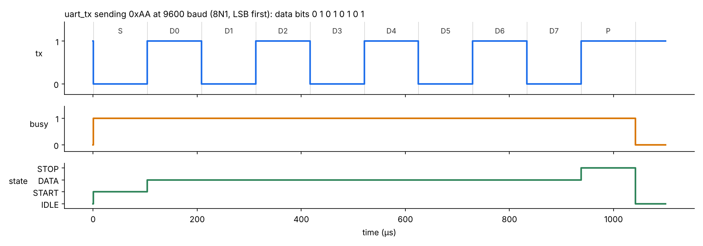
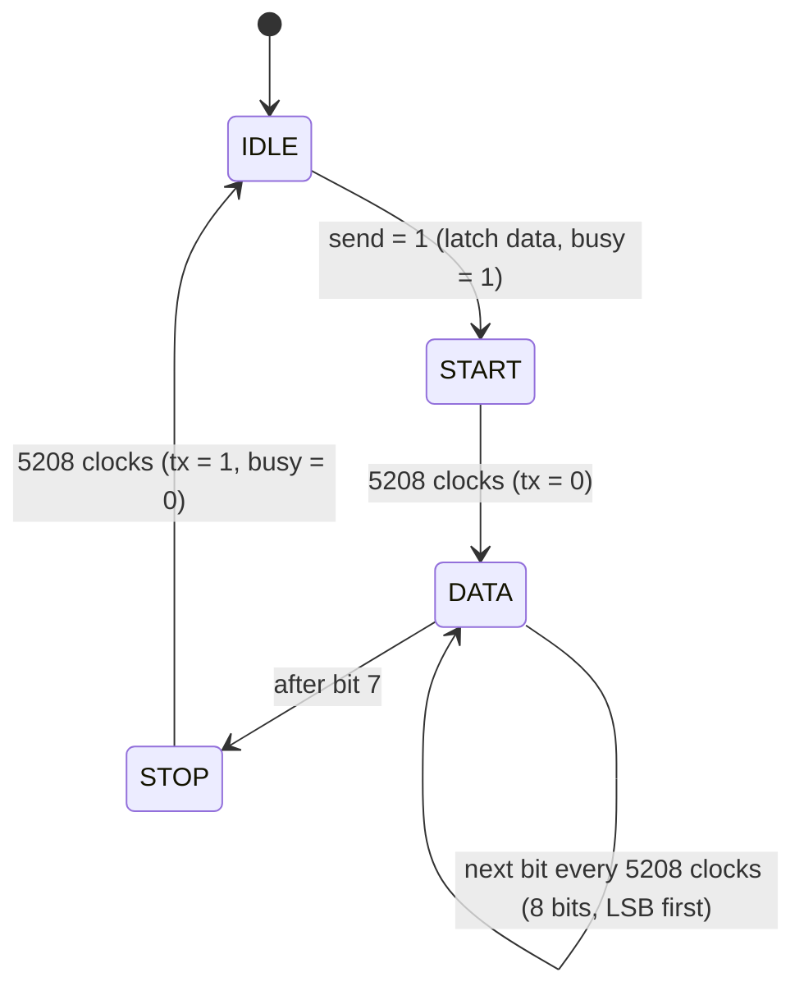
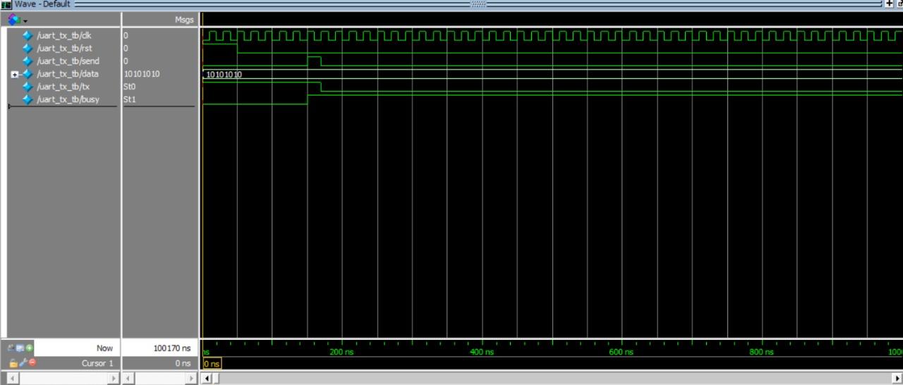

# UART Transmitter in Verilog

A UART transmitter written in Verilog: an 8N1 serial transmitter driven by a 4-state finite-state machine, running at 9600 baud from a 50 MHz clock, with a self-checking testbench that decodes and verifies every frame.

**Built:** May 2025 · Embedded systems course project

**Status:** verified in simulation (ModelSim and Icarus Verilog); not run on FPGA hardware.



## Results

| Metric | Result |
| --- | --- |
| Self-checking test | 5 of 5 bytes received correctly (0xAA, 0x55, 0x00, 0xFF, 0x4D) |
| Bit time | 104.16 µs (5208 clock cycles at 50 MHz) |
| Baud rate | 9600.6 baud, 0.006 % from the 9600 target |
| Frame time | 1041.6 µs per byte (start + 8 data + stop) |
| Test sensitivity | A deliberately broken version (MSB first) fails the test, as it should |

## How it works



| Port | Direction | Purpose |
| --- | --- | --- |
| `clk` | in | 50 MHz system clock |
| `rst` | in | Asynchronous reset (line idles high) |
| `send` | in | Start a transmission |
| `data[7:0]` | in | Byte to send, latched when `send` is seen |
| `tx` | out | Serial line: high when idle |
| `busy` | out | High while a frame is being sent |

1. **IDLE:** the line stays high. When `send` goes high, the byte is latched and `busy` rises.
2. **START:** the line is pulled low for one bit time.
3. **DATA:** the 8 data bits go out least-significant bit first, one per bit time.
4. **STOP:** the line returns high for one bit time, then `busy` drops and the FSM returns to IDLE.

A 13-bit counter sets the bit time: it counts 0 to 5207, so each bit lasts 5208 cycles. At 50 MHz that is 9600.6 baud.

## Engineering notes

**The original testbench stopped too early.** It ran for 100 µs, but at 9600 baud one bit lasts 104 µs and a full frame about 1.04 ms. The original ModelSim run therefore ended during the start bit, before any data bit appeared:



**A self-checking testbench fixes this.** `sim/tb_uart_tx_check.v` acts like a receiver. It waits for each start bit, samples the line in the middle of every bit, rebuilds the byte and compares it with what was sent. It also checks the idle level, start and stop bits, and reports the baud-rate error. To prove the checker can catch mistakes, the design was broken on purpose (bits sent MSB first): the test failed on 3 of 5 bytes (0x00 and 0xFF are symmetric, so they still pass).

## Repository layout

| File | Purpose |
| --- | --- |
| `rtl/uart_tx.v` | The transmitter module |
| `sim/uart_tx_tb.v` | Original testbench (sends 0xAA; runs 100 µs) |
| `sim/tb_uart_tx_check.v` | Self-checking testbench: 5 bytes, frame decoding, baud check, VCD dump |
| `media/` | Waveform images used in this README |

## Run it

With [Icarus Verilog](https://steveicarus.github.io/iverilog/):

```bash
iverilog -o uart_sim rtl/uart_tx.v sim/tb_uart_tx_check.v
vvp uart_sim
```

Expected output ends with `ALL TESTS PASSED (5 bytes)`. The run also writes `uart_tx.vcd`, which you can open in [GTKWave](https://gtkwave.sourceforge.net/) to see the waveform.

In ModelSim: create a project, add `rtl/uart_tx.v` and either testbench, compile, simulate the testbench, and run for at least 1.1 ms per byte (`run 6 ms` for the self-checking one).

## Limitations and next steps

- **Fixed baud rate:** 5207 is hard-coded. A `parameter` for clock frequency and baud rate would make it reusable.
- **`send` is level-sensitive:** holding it high keeps sending the same byte. An edge detector, or a one-clock `send` pulse as the testbench uses, avoids repeats.
- **No receiver yet:** a matching `uart_rx` with mid-bit sampling is the natural next module.
- **Not tested on hardware:** the next step is an FPGA board talking to a PC serial terminal.

## Author

**Michel Salame** — [LinkedIn](https://www.linkedin.com/in/michel-salame)
